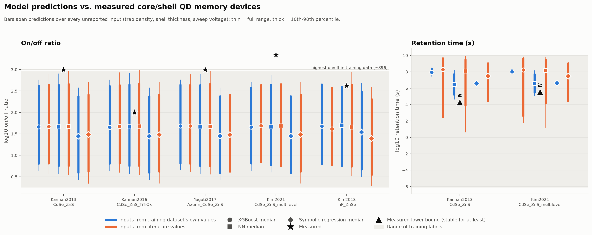

# Model vs. real experiment benchmark (Tier 3)

Regenerate everything here with `python scripts/literature/model_vs_experiment.py` (from the repo root).

## Bottom line

1. **The models cannot reproduce the best real devices' on/off ratios, and the training data is why.**
   The highest on/off ratio anywhere in the training data is ~896. Three of the five real devices report
   ~1,000–2,200 (CdSe/ZnS). Tree models can't predict above their highest training label and the NN barely
   approaches it, so these devices are out of reach for any input values. The two devices at 100 and 420
   are reproduced.
2. **The models' retention predictions are consistent with real devices, but that is a weak test.**
   Papers report retention as "stable for at least X" (20,000 s and 360,000 s here). Every model's median
   prediction (~10⁶–10⁸ s) clears those lower bounds, but a lower bound can't confirm a prediction of
   years.
3. **The training dataset's material values are not physical, and it misclassifies a textbook pair.**
   Every material property checked falls outside its literature range. Electron affinities sit near 0 eV
   (real: 3.4–4.8 eV), band gaps are 2–3× too small, and ZnS's dielectric constant is 53.6 (real: 8–10).
   Applying the dataset's own classification rule to its own values labels **InP/ZnSe, a well-established
   type-I pair, as type III**. This is the strongest evidence so far for the Tier 0 data-provenance question.
4. **The symbolic-regression equations (methodology paper) don't do better on real devices.** Within the
   training trap-density range they hit the same on/off ceiling as XGBoost and the NN. They reach the
   ~1,000–2,200 devices only if trap density is pushed 2–70× beyond anything in the training data. That
   shows the equations can *represent* these devices, not that they *predict* them (see below).
5. **Hysteresis is not benchmarked.** Papers report set/reset voltages of bipolar sweeps (a 3.6–7 V span
   for these devices). That is a different quantity from this project's `hysteresis_window_V`, and it is
   also above the largest hysteresis value in the training data.

## Method

**Devices.** Five 2-terminal, rewritable core/shell quantum-dot memories that the model can represent:
four CdSe/ZnS and one InP/ZnSe (`measured_devices.csv`, `modelled = True`). Three more measured devices
are recorded but not modelled: a two-shell InP/ZnSe/ZnS device, and two 3-terminal transistors.

**Unknown inputs are swept, not guessed.** No paper reports trap density (`Nt_cm3`), the dominant driver
of on/off ratio. Most also omit shell thickness, and some omit the sweep voltage or even the particle size.
Each unknown is swept over its plausible or training range (`benchmark_inputs.csv` lists every device's
grid):

- trap density: 25 log steps across the training range, 1×10¹⁵ to 1×10¹⁹ cm⁻³
- shell thickness: 0.3–1.0 nm (about 1–3 ZnS monolayers); core radius is the rest of the reported diameter
- core radius, when no diameter is reported: 1.5–3.0 nm
- sweep voltage, when unreported: 1–5 V

The model's answer for a device is the band of predictions over that grid, not a single number. A
measurement "is reproduced" if it falls inside the band. The trap densities that reproduce it to within a
factor of 2 are listed in `benchmark_results.csv`.

**Three models.** The saved XGBoost and NN models, plus the symbolic-regression equations (see below).

**Two sources for material inputs.**
- *Dataset*: band offsets and dielectric constant computed from the training dataset's own values for
  these materials. This is exactly what a generated candidate for the pair would have looked like.
- *Literature*: the same quantities from published values, using the ranges in
  `literature_pair_offsets.csv`.

## Results

### On/off ratio

| Device | Measured | Predicted median (p10–p90) | Reproduced? | Trap density that reproduces it (×2) |
|---|---|---|---|---|
| Kannan 2013, CdSe/ZnS | ~1,000 | 41–50 (≈6–470) | No, just above the training ceiling | only the top ~8% of the range, 4.6×10¹⁸–1×10¹⁹ cm⁻³ |
| Kannan 2016, CdSe/ZnS + TiOx | 100 | 41–50 (≈6–470) | **Yes**, within p10–p90 | 1×10¹⁷–3×10¹⁸ cm⁻³ |
| Yagati 2017, azurin/CdSe-ZnS | ~1,000 | 41–50 (≈6–470) | No, just above the training ceiling | only 4.6×10¹⁸–1×10¹⁹ cm⁻³ |
| Kim 2021, CdSe/ZnS | 2,200 | 41–50 (≈6–470) | **No**, at any input | none in the training range |
| Kim 2018, InP/ZnSe | 420 | 41–50 (≈6–470) | **Yes**, within the band | 1×10¹⁸–1×10¹⁹ cm⁻³ |

Ranges shown are representative; exact per-model, per-source numbers are in `benchmark_results.csv`. All
four model/input combinations agree closely on on/off ratio. Swapping dataset inputs for literature inputs
barely moves on/off predictions, because they are dominated by trap density, not band offsets. For the same
reason, the predicted bands look almost identical across devices: without a measured trap density, the
model has nothing to tell these devices apart.

### Retention

| Device | Measured (lower bound) | XGBoost median, dataset / literature inputs | NN median, dataset / literature inputs | Consistent? |
|---|---|---|---|---|
| Kannan 2013 | ≥ 2.0×10⁴ s | 8.4×10⁷ / 1.9×10⁸ s | 3.0×10⁶ / 1.3×10⁸ s | Yes |
| Kim 2021 | ≥ 3.6×10⁵ s | 1.0×10⁸ / 1.7×10⁸ s | 3.6×10⁶ / 1.3×10⁸ s | Yes |

Unlike on/off, retention predictions depend heavily on which input source is used. With dataset inputs,
XGBoost's band is narrow (~10⁷·⁷–10⁸·⁴ s). With literature inputs it spans about seven orders of magnitude
(~10²·⁵–10⁹·⁷ s). This matches the earlier finding that retention is driven by the band offsets, and those
offsets are exactly the inputs the dataset gets wrong. So the dataset's unphysical material values matter
most for retention.

### Symbolic-regression equations

The third model is the physics-constrained symbolic regression from `scripts/symbolic_model.py`. It is fit
on the same seed-42 training split as the saved XGBoost/NN models:

- `log10 on/off = −3.98 + 0.01493·(lgNt)² + 1.641·√Bmax − 8.644·Bmax/lgNt`
- `log10 retention = −23.22 + 48.39·√Bmax − 18.88·Bmax + 0.735·Bmax²`

Here `lgNt` = log10 of trap density and `Bmax` = max(|dE_LUMO|, |dE_HOMO|).

Unlike tree models, an equation can predict beyond the training labels. So for the equations only, a
measurement the normal Nt sweep can't reach is re-checked with Nt extended up to 1×10²¹ cm⁻³
(`Nt_extended_reproducing` in `benchmark_results.csv`).

| Device | Measured on/off | Equation median, dataset / literature inputs | Reproduced in the training Nt range? | Nt needed if extended |
|---|---|---|---|---|
| Kannan 2013 | ~1,000 | 28 / 30 | Literature inputs only, at the top edge (1×10¹⁹) | 2×10¹⁹–1.5×10²⁰ (dataset inputs) |
| Kannan 2016 | 100 | 28 / 30 | **Yes**, 2×10¹⁷–5×10¹⁸ | — |
| Yagati 2017 | ~1,000 | 28 / 30 | Literature inputs only, at the top edge (1×10¹⁹) | 2×10¹⁹–1.5×10²⁰ (dataset inputs) |
| Kim 2021 | 2,200 | 28 / 30 | **No** | 5×10¹⁹–7×10²⁰ |
| Kim 2018, InP/ZnSe | 420 | 35 / 25 | Within ×2 at 3×10¹⁸–1×10¹⁹, but just outside the band with literature inputs (max 2.60 vs 2.62) | — |

- **The extended-Nt matches are extrapolation, not validation.** Those trap densities are 2–70× past the
  training maximum, and ~10²⁰ cm⁻³ is physically very high. They also rest on an on/off law learned from
  labels this report already shows are built on unphysical inputs.
- **Within the training range, the equations are slightly worse than XGBoost/NN.** Their median is about
  0.2 log10 lower, and they miss InP/ZnSe with literature inputs, where XGBoost/NN don't.
- **Retention:** all models are consistent with both lower bounds. With dataset inputs the equation gives one
  value per device, 10⁶·⁶ s, not a band, because it depends only on `Bmax` and each pair has one `Bmax`. That
  is the same finding as the methodology work: the training labels' retention ignores shell thickness, trap
  density and voltage. With literature inputs the band is 10⁴·⁴–10⁹·⁰ s (XGBoost: 10²·⁵–10⁹·⁷ s).

### Provenance: the dataset's values vs. literature (`provenance_check.csv`)

| Material / pair | Property | Dataset | Literature |
|---|---|---|---|
| CdSe | electron affinity | 0.27 eV | 4.8 eV |
| ZnS | electron affinity | **−0.25 eV** | 3.4–4.1 eV |
| CdSe | band gap | 0.56 eV | 1.75–1.90 eV |
| ZnS | band gap | 2.02 eV | 3.52–3.84 eV |
| ZnS | dielectric constant | 53.6 | 8.0–10 |
| CdSe/ZnS | dE_LUMO / dE_HOMO | −0.52 / −0.94 eV | −1.4…−0.7 / −1.07…−0.6 eV |
| CdSe/ZnS | band alignment | Type I ✓ | Type I |
| InP/ZnSe | dE_LUMO / dE_HOMO | **+0.59** / −1.30 eV | −0.8…−0.4 / −1.0…−0.57 eV |
| InP/ZnSe | band alignment | **Type III (broken gap)** ✗ | Type I |

The band gaps look like Materials Project's DFT values, which are known to underestimate real gaps. That
explains the gaps but not the electron affinities: every dataset electron affinity is flagged
`chi_is_estimated`, and they cluster near 0 eV instead of 3.4–4.8 eV. That looks like the AI-assisted
extraction recorded some other quantity than the electron affinity. Offsets are *differences* of these
values, so part of the error cancels. That is why CdSe/ZnS still comes out type I. But it doesn't cancel
for InP/ZnSe, which flips from type I to type III.

## Limitations

- **Five devices, one search pass.** Two have full texts read; the rest rely on abstracts or search
  summaries. A paper-ready benchmark needs more devices, ideally ones reporting trap density or
  enough detail to bound it.
- **Retention is only checked against lower bounds.** No paper here reports a fitted retention time
  constant, which is what the model predicts.
- **Material constants rest partly on secondary sources** (see `SOURCES.md`). The provenance conclusion
  survives that, because the dataset's values miss by ~4 eV and source disagreement is ~0.5 eV. The
  exact offset ranges need full-text checking.
- **Device differences the model can't see.** The model has no input for device stack, polymer matrix,
  electrodes, or measurement protocol, all of which differ widely across these papers.
